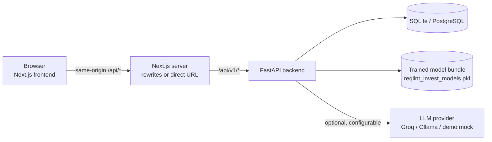

# ReqLint

ReqLint is a bilingual (Indonesian/English) **user-story quality assurance tool** for Agile teams.
It lints draft user stories against the **INVEST criteria** (Independent, Negotiable, Valuable,
Estimable, Small, Testable) and the **Connextra template** (*As a …, I want …, so that …*), detects
defects derived from **ISO/IEC/IEEE 29148** quality characteristics, and produces an audit with
scores, findings, and revision suggestions.

A user story can be evaluated by three interchangeable evaluators:

| Evaluator | What it does | Default |
|---|---|---|
| **Rule-based** (Stage 1) | Deterministic NLP: spaCy parsing + bilingual lexicons detect ambiguity, incompleteness, weak directives, and passive voice. Always available, offline. | ✅ |
| **Traditional ML** (Evaluator B) | Genuine scikit-learn inference: six trained logistic-regression pipelines score the six INVEST criteria with real probabilities. Requires the trained model bundle (shipped in the Docker image). | — |
| **LLM / SLM** (Evaluator C) | Classifies the six INVEST criteria via a configurable LLM provider (Groq / Ollama / offline demo mock). Optional; needs provider configuration. | — |

Transparency is a design goal: the UI always shows **which evaluator actually produced a result**
(`requested_evaluator` vs `actual_evaluator`), the model version, and whether Stage-2 suggestions
come from a real provider or the built-in demo mock. A requested evaluator that fails is reported
as an explicit error — results are never silently substituted.

## Problem statement

Ambiguous and unverifiable user stories are a common source of rework in Agile projects. Issues
such as vague adjectives ("fast", "easy"), missing benefits, weak directives ("should", "can"), and
passive voice make a story hard to estimate and test. ReqLint moves this quality check to the left:
drafts are linted while they are written, before they enter a sprint.

## Project objectives

- Detect concrete, explainable defects in user stories in both Indonesian and English.
- Score drafts (0–100) with per-category findings and highlighted text spans.
- Evaluate INVEST compliance with three interchangeable, honestly-labeled evaluators.
- Keep every evaluation reproducible: evaluator provenance and model version are stored with the audit.

## Implemented features

- **Editor** with live linting (in-browser rule engine), clause/word stats, and draft templates.
- **Three-evaluator audit pipeline** with a shared evaluation contract (equal-weighted 0–100 scoring).
- **Stage-2 advisory generation**: verdict-preserving AI rewrite + Gherkin acceptance criteria
  (real provider, or clearly-labeled demo mock when no provider is configured).
- **One-click apply** of AI suggestions and manual revision, both with synchronous re-scoring.
- **PDF/TXT/MD import** (PDF text extraction server-side, size and empty-text validation).
- **Audit history** with search, filters, and sorting (server-side pagination).
- **Bilingual exports** — Markdown, CSV, JSON from the UI; PDF/MD/JSON from the API.
- **Indonesian/English UI** (501 translation keys, client-side locale switching).
- **Accounts**: JWT auth (register, login, password reset with optional SMTP delivery).

See [docs/features/product-overview.md](docs/features/product-overview.md) for the full,
implementation-verified feature list — including what is partial or simulated.

## Architecture (high level)



The FastAPI backend owns all analysis logic. `ai-engine/` is a Python workbench (training corpora,
pipelines, experiments) that is **not** a runtime service — see
[docs/architecture/system-overview.md](docs/architecture/system-overview.md).

## Technology stack

| Layer | Technology |
|---|---|
| Frontend | Next.js 14 (App Router), React 18, TypeScript, Tailwind CSS, axios, Vitest, Cypress |
| Backend | Python, FastAPI, SQLAlchemy 2 (async), Pydantic v2, PyJWT, bcrypt |
| NLP / ML | spaCy (`en_core_web_sm`), scikit-learn 1.7.2, joblib, PyMuPDF, ReportLab |
| LLM integration | Direct HTTP (httpx) to Groq (OpenAI-compatible) or Ollama; built-in demo mock |
| Data | SQLite (default) or PostgreSQL via SQLAlchemy async; optional Redis/Celery execution mode |
| Deployment | Docker (root build context), Docker Compose, Coolify |

## Getting started

Prerequisites: **Python 3.11+** and **Node.js 18+** (Docker 24+ optional).

```bash
# 1. Backend (terminal 1)
python -m venv .venv && .venv\Scripts\activate        # Linux/macOS: source .venv/bin/activate
pip install -r backend/requirements.txt -r ai-engine/requirements-ai.txt
python -m spacy download en_core_web_sm
uvicorn app.main:app --app-dir backend --reload --port 8000

# 2. Frontend (terminal 2)
cd frontend-qa
npm ci --legacy-peer-deps
npm run dev                                            # http://localhost:3000
```

The backend starts with SQLite (`./reqlint.db`) and runs without any LLM provider
(`SLM_PROVIDER=mock`). The Traditional ML evaluator works out of the box when the repository
checkout (including `pm-docs/`) is intact. Details and configuration:
[docs/getting-started/installation.md](docs/getting-started/installation.md) ·
[docs/getting-started/configuration.md](docs/getting-started/configuration.md).

## Basic usage

1. Open `http://localhost:3000`, register or use **Log in → demo account**.
2. Write or paste a user story in the editor (Indonesian or English), choose an evaluator, and run **Audit User Story**.
3. Review the scorecard, findings, INVEST dimension results (with confidences for ML/LLM evaluators), and the Stage-2 advisory rewrite.
4. Apply suggestions or edit manually (the score is recalculated), then export the result.

## Testing

```bash
# Backend unit/integration/API tests (119 tests, verified on this codebase)
python -m pytest backend/tests -q

# pytest-bdd suite (34 scenarios)
python run_bdd.py

# Frontend unit tests (74 Vitest cases)
cd frontend-qa && npm test
```

BDD scenario counts and scope: [docs/development/testing.md](docs/development/testing.md).
CI currently runs syntax compilation checks and frontend lint only — it does **not** run the test suites.

## Deployment

Docker images build from the **repository root** context (`backend/Dockerfile`,
`frontend-qa/Dockerfile`). The backend image requires the trained ML bundle from
`pm-docs/rubrics/reqlint_invest_models.pkl` to be present in the build context —
see [docs/deployment/docker.md](docs/deployment/docker.md). Coolify guides:
[DEPLOY_COOLIFY.md](DEPLOY_COOLIFY.md) (two applications) and
[DEPLOY_COOLIFY_COMPOSE.md](DEPLOY_COOLIFY_COMPOSE.md) (single-domain compose stack).

## Documentation

| Document | Content |
|---|---|
| [docs/getting-started/](docs/getting-started/installation.md) | Installation, local development, configuration reference |
| [docs/architecture/](docs/architecture/system-overview.md) | System overview, backend, frontend, database, data flow |
| [docs/features/](docs/features/product-overview.md) | Product features, rule-based analysis, Traditional ML, LLM evaluation |
| [docs/api/api-reference.md](docs/api/api-reference.md) | REST API reference (all endpoints, schemas, errors) |
| [docs/development/testing.md](docs/development/testing.md) | Test suites and how to run them |
| [docs/deployment/docker.md](docs/deployment/docker.md) | Docker build, compose, build-context requirements |

Course deliverables and per-task reports (SRS, BPMN, pitch deck, annotation guideline, task 04–10
reports) are indexed in [docs/README.md](docs/README.md).

## Known limitations

- **Demo mock is not AI.** Without a configured LLM provider, Stage-2 suggestions are generic
  built-in templates, explicitly labeled in the UI. The LLM evaluator refuses to run on the mock.
- **Traditional ML context features.** The 10 backlog-context features (similarity/category
  position) use neutral defaults in single-story serving mode; they were computed over a full
  backlog at training time. This limitation is stored in audit metadata.
- **Evaluation quality varies per criterion.** Embedded training metrics of the shipped bundle
  range from F1 ≈ 0.49–0.90 depending on criterion and language — see
  [docs/features/traditional-ml.md](docs/features/traditional-ml.md).
- **No independently verified security audit.** Security features (JWT, bcrypt, ownership checks,
  fail-fast secrets) are implemented and unit-tested, but no third-party audit has been performed.
- **Contact form is simulated** and the password-reset email is only sent when SMTP is configured.
- **CI does not run tests**, and the Cypress E2E spec targets a UI that has been replaced.
- **Alembic migration is behind the models**; startup uses `create_all` plus an idempotent column patch.

## Project layout

```
backend/       FastAPI application (app/), tests, Dockerfile
frontend-qa/   Next.js app (src/), unit + E2E tests, Dockerfile
ai-engine/     Python NLP/ML workbench: corpora, training pipelines, experiments (no runtime service)
pm-docs/       Product-management docs, annotation rubrics, INVEST datasets, trained model bundle
docs/          Project documentation (this overhaul) + course deliverables + task reports
features/      Behave E2E suite (Selenium) for local/full-stack runs
```

The four team workspaces (`pm-docs/`, `ai-engine/`, `backend/`, `frontend-qa/`) are described in
[CONTRIBUTING.md](CONTRIBUTING.md).
