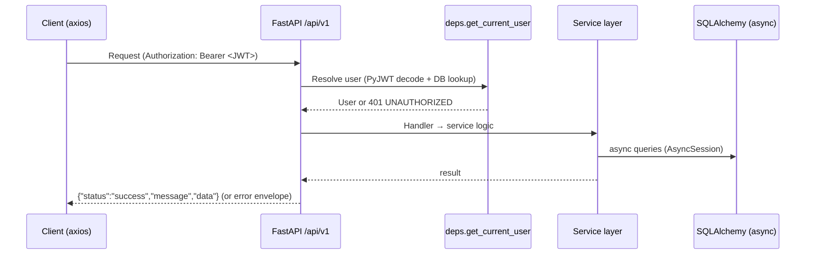

# Backend architecture

The backend is a FastAPI application in `backend/app/`. Verified against `bfe72aa`.

## Layout

```
backend/app/
├── main.py            FastAPI app: lifespan, CORS, exception handlers, routers
├── api/
│   ├── deps.py        get_current_user / get_optional_current_user (Bearer JWT)
│   └── v1/            routers: health, auth, documents, audits, lint, endpoints/requirements
├── core/              config.py (settings + security guard), security.py (JWT/bcrypt),
│                      database.py (async engine/session), errors.py, responses.py
├── db/                models.py (7 ORM tables), init_db.py (create_all + column patch)
├── lexicon/           vague_terms_id.txt, vague_terms_en.txt, weak_directives.txt
├── schemas/           pydantic request/response models
├── services/          audit_service, nlp_stage1, nlp_stage2, invest_ml_service,
│                      evaluation_contract, story_parser, scoring, pdf_service,
│                      export_service, auth_service
└── workers/           celery_app.py + tasks.py (dormant unless AUDIT_EXECUTION_MODE=celery)
```

## Startup and request lifecycle

`main.py` lifespan runs `init_db()` (create tables, patch missing columns) and
`load_stage1_resources()` (spaCy `en_core_web_sm` with a `spacy.blank("en")` fallback, plus the
bilingual lexicons into a `PhraseMatcher`). There is no ML-bundle preload —
`InvestMLService` loads it lazily on first use.



## Response envelope

Success — `core/responses.py` `success_response()`:

```json
{"status": "success", "message": "<string>", "data": { }}
```

Two exceptions return non-enveloped bodies: `POST /api/v1/requirements/audit` (bare pydantic
`AuditResponse`) and `GET /api/v1/audits/{id}/export` (raw file bytes with
`Content-Disposition`).

Errors — `core/errors.py` handlers for `AppException`, `HTTPException`, `RequestValidationError`,
and a global 500 handler:

```json
{"status": "error", "message": "<string>", "error_code": "<STABLE_CODE>", "errors": [{"field": "...", "message": "..."}]}
```

Stable error codes are used across the API (e.g. `INVALID_CREDENTIALS`, `EMAIL_TAKEN`,
`EMPTY_DRAFT`, `DRAFT_TOO_LONG`, `INVALID_EVALUATOR`, `ML_EVALUATOR_UNAVAILABLE`,
`LLM_PROVIDER_TIMEOUT`, `AUDIT_NOT_READY`, `UNSUPPORTED_FORMAT`, `VALIDATION_ERROR`).

## Authentication

`backend/app/api/deps.py` reads the raw `Authorization` header:

- `get_current_user` — requires `Bearer <JWT>`; decodes with PyJWT (`sub` = user id), loads the
  user, raises `401 UNAUTHORIZED` on any failure.
- `get_optional_current_user` — same parsing, returns `None` instead of raising (guest mode;
  used only by `POST /documents/upload`).

Login uses a pre-computed bcrypt dummy hash for unknown emails so response timing does not reveal
account existence (`core/security.py`).

## Services

| Service | Responsibility |
|---|---|
| `audit_service.AuditService` | Two-phase audit pipeline (evaluate → generate), plus audit CRUD: create, status poll, detail, list (pagination/filters), reanalyze, apply recommendation, manual revision |
| `nlp_stage1.NLPStage1Service` | Deterministic Stage-1 analysis: story splitting, Connextra structure parsing, ambiguity / incompleteness / weak-directive / passive-voice detection |
| `story_parser.StoryParser` | Draft → stories (offset-preserving) + Role/Means/End parsing (ID & EN) |
| `scoring.ScoringService` | Penalty-based 0–100 score, ISO 29148 / INVEST breakdown (missing data stays `null`, never fabricated) |
| `invest_ml_service.InvestMLService` | Traditional ML evaluator: lazy bundle load, 23-feature vector, six `predict_proba` pipelines; strict no-fallback for `evaluate_story_ml`, heuristic fallback only in the legacy `evaluate_story` |
| `nlp_stage2.NLPStage2Service` | Stage-2 LLM integration: provider calls (mock/ollama/openai_compatible), evaluator C classification, verdict-preserving generation, provider error mapping |
| `evaluation_contract` | Shared evaluation schema: six criteria, three evaluators, equal-weighted score, verdict rules |
| `pdf_service.PDFService` | PDF validation (extension, size, `%PDF` magic), PyMuPDF extraction in an executor, sanitization, truncation, temp-file cleanup |
| `export_service.ExportService` | Bilingual JSON/Markdown/PDF rendering (ReportLab for PDF) |
| `auth_service.AuthService` | Registration (password policy), login (JWT), password reset (SHA-256 token hash, 1 h expiry, SMTP delivery when configured) |

## Execution modes

`AUDIT_EXECUTION_MODE=inline` (default) runs audits with FastAPI BackgroundTasks. With `celery`,
`POST /audits` dispatches `run_audit_task.delay()` and persists the Celery task id, falling back to
inline on dispatch failure. The worker code exists (`app/workers/`, JSON serialization, a beat
schedule for temp-file cleanup every 15 min) but **nothing in the repository starts a worker or
beat process**, and the compose files define no Redis-backed worker service — inline is the
supported mode.

## Health check semantics (honest notes)

`GET /api/v1/health` reports `db` from a real `SELECT 1`; `redis` is reported `"up"` **without
being checked** unless `AUDIT_EXECUTION_MODE == "celery"`; `slm` reports `"mock"` when
`SLM_PROVIDER=mock`, otherwise `"up"` (it never reports `"down"`). Treat `redis: "up"` in inline
mode as "not applicable", not as a verified Redis connection.

## Known dead code (do not document as features)

- `backend/app/api/v1/endpoints/health.py` — an unregistered `GET /health` route (never wired).
- `TemuanCacat.kriteria_penerimaan` — an ORM column that is never written or read.
- `DocumentUploadResponse`, `LintFinding`, `AcceptanceCriteriaItem`, `AIRecommendation` —
  pydantic schemas defined but unused (handlers build dicts directly).
