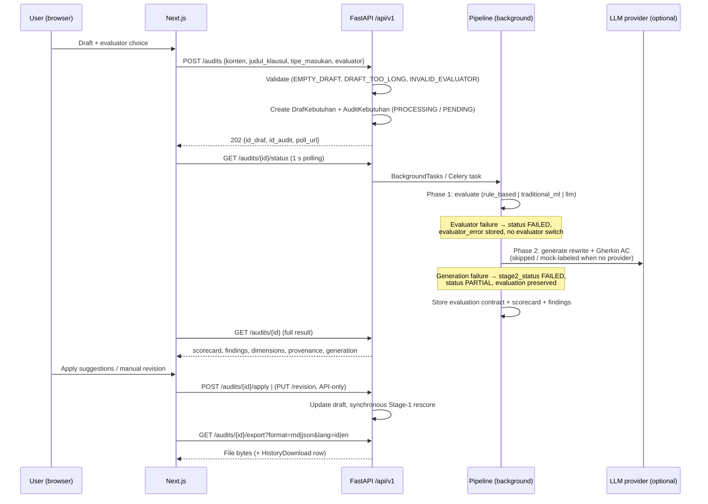

# Data flow

The end-to-end lifecycle of an audit, as implemented in `backend/app/services/audit_service.py`
and consumed by `frontend-qa/src/app/(app)/audit/[id]/page.tsx`.

## Audit lifecycle

## Phase 1 — evaluation (one evaluator per audit)

| Evaluator | Implementation | Result |
|---|---|---|
| `rule_based` | Stage-1 NLP (`nlp_stage1`, `story_parser`) + penalty scoring (`scoring`) | Findings with spans; INVEST dimensions honestly reported `INSUFFICIENT_EVIDENCE` (the rule engine does not judge them) |
| `traditional_ml` | `InvestMLService.evaluate_story_ml` — six `predict_proba` pipelines over a 23-feature vector, threshold 0.5 | Per-criterion PASS/FAIL with confidence ∈ [0,1]; raises `MLEvaluatorUnavailableError` when the bundle is missing/corrupt |
| `llm` | `NLPStage2Service.classify_story_with_llm` — provider chat call, labels coerced to PASS/FAIL/INSUFFICIENT_EVIDENCE | Per-criterion labels with reasons; refuses to run on the mock provider (`LLM_EVALUATOR_UNAVAILABLE`) |

The result is normalized by `evaluation_contract.py` into an immutable contract stored in
`audit_kebutuhan.breakdown["evaluation"]`: per-dimension labels/confidences, equal-weighted
0–100 `invest_framework_score` (INSUFFICIENT_EVIDENCE excluded, renormalized), overall verdict
(any FAIL → FAIL).

## Phase 2 — advisory generation

`NLPStage2Service.generate_response` produces a rewrite + Gherkin acceptance criteria grounded in
the evaluation (dimension verdicts + rationales, or rule findings). It is **verdict-preserving**:
generated content must not flip the evaluation outcome. With `SLM_PROVIDER=mock` the output is a
deterministic bilingual template explicitly labeled `ai_suggestion_source: "mock"` ("bukan analisis
AI nyata"). A real provider is used only when configured (Groq / Ollama). Generation failure keeps
the Phase-1 evaluation intact and marks the audit `PARTIAL`.

## Provenance surfaced to the user

`GET /audits/{id}` always returns `evaluator`, `requested_evaluator`, `actual_evaluator`,
`model_version` (Traditional ML), `evaluator_error_code`, and `ai_suggestion_source` — the UI
renders these as a provenance banner. A user can always tell which engine produced a score and
whether Stage-2 content is AI-generated or demo mock.

## Scoring

`ScoringService.calculate_score` computes a 0–100 score: category penalties
(`TIDAK_LENGKAP` 15, `AMBIGUITY` 8, `PASSIVE_VOICE` 6, `WEAK_DIRECTIVE` 5) × severity multipliers
(LOW 0.5 / MEDIUM 1.0 / HIGH 1.5), averaged across stories. Where the pipeline supplies INVEST
results with failures, an additional 4.0 points are deducted per failed criterion — this applies
to the legacy `/requirements/audit` analyzer path; the rule-based audit path reports INVEST
dimensions as `INSUFFICIENT_EVIDENCE`, so no such deduction occurs there. `compute_breakdown`
derives ISO 29148 / INVEST sub-scores — dimensions without evidence are returned as `null`, never
fabricated. The UI shows "–" for those.
