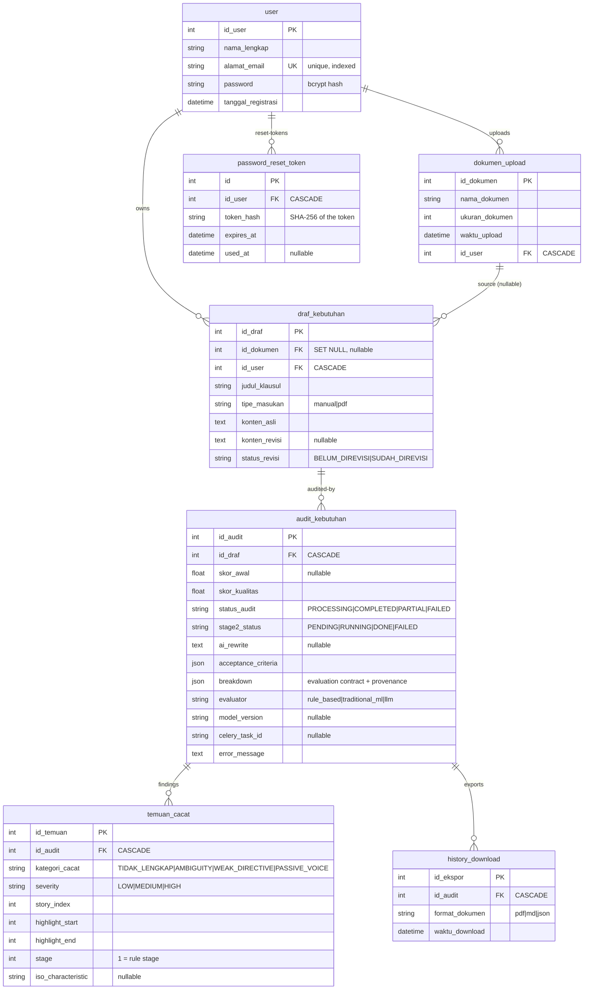

# Database

The backend uses SQLAlchemy 2 (async) over SQLite (default) or PostgreSQL, defined in
`backend/app/db/models.py` (7 tables) and wired in `backend/app/core/database.py`.

## Entity relationships

Delete cascades: removing a `user` removes their documents, drafts, audits, findings, exports, and
reset tokens (`ondelete CASCADE`, `cascade="all, delete-orphan"`); deleting a document keeps its
drafts (`SET NULL`).

## Audit state fields

- `status_audit` — `PROCESSING` → `COMPLETED` (evaluation + generation OK), `PARTIAL`
  (evaluation OK, Stage-2 generation failed), or `FAILED` (evaluator error; coded reason in
  `breakdown["evaluator_error"]`).
- `stage2_status` — `PENDING` / `RUNNING` / `DONE` / `FAILED`.
- `breakdown` (JSON) — the immutable evaluation contract, ISO 29148 / INVEST sub-scores, evaluator
  provenance (`requested_evaluator`, `actual_evaluator`, `evaluator_error`), and the documented
  serving-mode limitation for Traditional ML context features.
- `evaluator` — persisted choice (`rule_based` default; `traditional_ml` / `llm` selectable).

## Schema management

- **Startup creates the schema**: the app lifespan runs `Base.metadata.create_all`
  (`db/init_db.py`), then `_ensure_audit_columns` idempotently adds the `evaluator` and
  `model_version` columns to `audit_kebutuhan` when missing (SQLite via `PRAGMA table_info`,
  PostgreSQL via ignored-exception `ALTER`s).
- **Alembic is present but not wired into startup.** `backend/alembic/` contains a single
  `initial_schema` revision (2026-10-24) that **predates** the `evaluator`/`model_version`
  columns — running `alembic upgrade head` alone would produce a schema missing those columns.
  Fresh installs (the supported path) rely on `create_all`. Aligning the migration history is
  tracked as a known gap in [README → Known limitations](../../README.md#known-limitations).

## Data lifecycle (verified behavior)

| Data | Created | Deleted |
|---|---|---|
| Drafts + audits | `POST /audits` (a `DrafKebutuhan` + `AuditKebutuhan` row) | Only by DB-level cascade (no delete API for backend rows) |
| Findings | Rule-based evaluation (`stage=1`) | Cleared and regenerated by `POST /audits/{id}/reanalyze` |
| Export records | Successful `GET /audits/{id}/export` | With the parent audit |
| Reset tokens | `POST /auth/forgot-password` | Marked used (`used_at`) on successful reset; expire after 1 h |
| PDF temp files | `POST /documents/upload` | Deleted immediately after extraction; volume **not** persisted in compose deployments |
