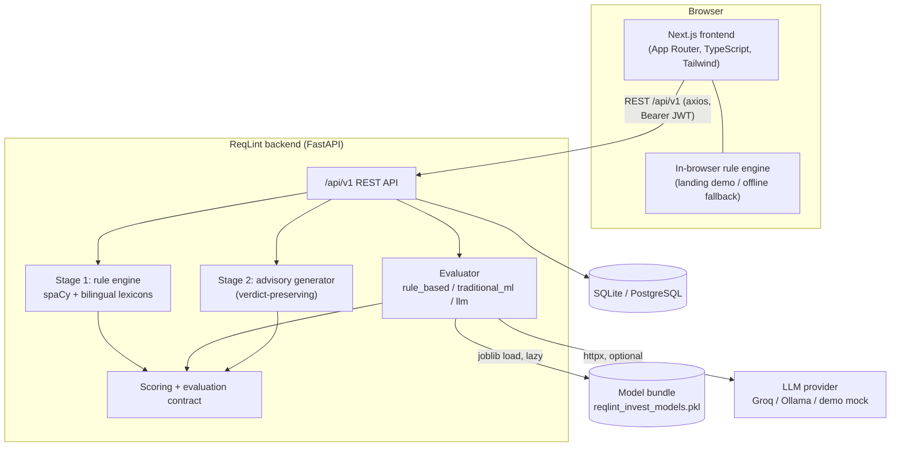
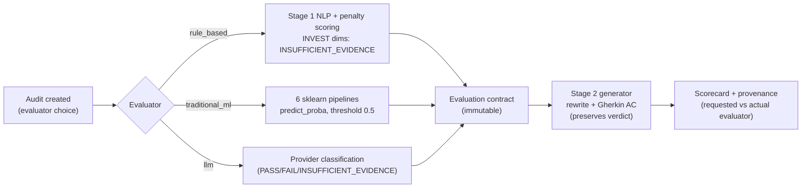

# System overview

ReqLint is a two-service web application with an optional LLM provider integration. All analysis
logic lives in the FastAPI backend; the Next.js frontend renders the workspace and, for the landing
page demo and offline fallback, runs a small copy of the rule engine in the browser.

## Components

| Component | Implementation | Notes |
|---|---|---|
| Frontend | `frontend-qa/` — Next.js 14 App Router, TypeScript, Tailwind, axios | 10 pages; bilingual UI (501 keys); JWT in `localStorage`; see [frontend.md](frontend.md) |
| Backend | `backend/` — FastAPI, SQLAlchemy 2 async, Pydantic v2 | 18 endpoints under `/api/v1` (+ root `GET /`); see [backend.md](backend.md) |
| Data | SQLite (default) or PostgreSQL (asyncpg) | 7 ORM tables; schema created at startup, see [database.md](database.md) |
| Model bundle | `pm-docs/rubrics/reqlint_invest_models.pkl` | Six scikit-learn pipelines, version `2.1.0-srs-hybrid`; see [../features/traditional-ml.md](../features/traditional-ml.md) |
| LLM provider | Groq (OpenAI-compatible) or Ollama, via httpx | Optional; `SLM_PROVIDER=mock` (default) is a labeled demo generator; see [../features/llm-evaluation.md](../features/llm-evaluation.md) |
| Work queues | Celery + Redis (optional) | Wired but **dormant by default** (`AUDIT_EXECUTION_MODE=inline`); no compose service starts a worker |

## The `ai-engine/` directory is not a runtime service

`ai-engine/` contains the training corpora, corpus/perturbation pipelines, experiment scripts, and
the original prototype engine (`ReqLintEngine`). The backend **does not import any of it** — the
production pipeline lives entirely in `backend/app/services/`. The backend Docker image copies
`ai-engine/` into the image only because `backend/Dockerfile` installs
`ai-engine/requirements-ai.txt` from that directory (spaCy is the one dependency backend code
imports from it). Neither compose file defines an ai-engine service.

## Evaluation architecture

Every audit persists one evaluator choice (`evaluator` column, default `rule_based`). The
Task-06 pipeline evaluates the draft with exactly that evaluator and stores the result as an
immutable evaluation contract; evaluator failures mark the audit `FAILED` with a coded error
(`ML_EVALUATOR_UNAVAILABLE`, `LLM_EVALUATOR_UNAVAILABLE`, …) and **never silently switch
evaluators**. Stage 2 then generates advisory content (rewrite + Gherkin acceptance criteria) that
preserves the evaluation verdict.

Request-level flow and the audit lifecycle are detailed in [data-flow.md](data-flow.md); the
backend internals in [backend.md](backend.md).
