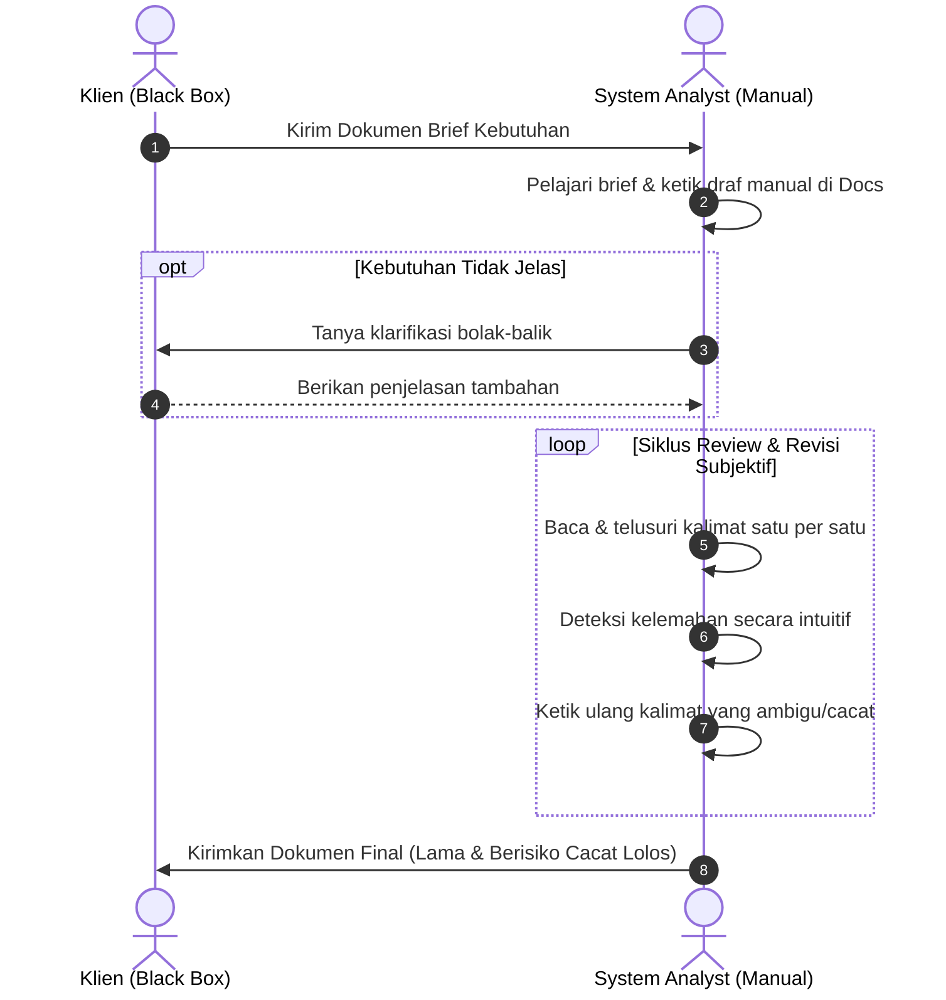
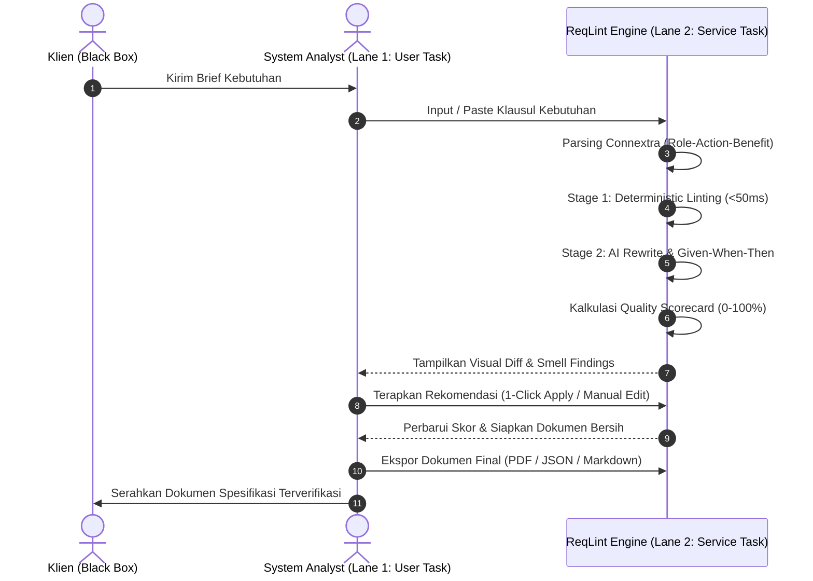

# 🔄 Pemodelan & Analisis Proses Bisnis: As-Is vs To-Be ReqLint
> **Tugas Pemodelan Proses Bisnis (BPMN) • PPL Praktikum I4 • Kelompok 3**  
> **Studi Kasus**: Rekayasa Kebutuhan Perangkat Lunak (*Requirements Engineering*) — Proses Verifikasi dan Penjaminan Mutu Spesifikasi Kebutuhan (*Klausul SRS Bab 3 & Agile User Stories*).

---

## 🎯 1. Ringkasan Kasus & Tujuan
Dokumen ini memodelkan perbandingan mendalam antara proses verifikasi spesifikasi kebutuhan perangkat lunak eksisting (*As-Is*) yang dilakukan secara manual konvensional dengan proses baru berbasis sistem automasi (*To-Be*) menggunakan platform **ReqLint (Requirement Analyzer via NLP)**, serta mengukur dampak efisiensi waktu, konsistensi mutu, dan optimasi biayanya.

---

## ⏳ 2. Proses Bisnis As-Is (Sebelum Menggunakan Sistem)

### 2.1 Struktur Pool & Aktor
* **Klien (*Black Box Pool*)**: Pengirim brief kebutuhan awal dan penerima dokumen spesifikasi final.
* **System Analyst (*White Box Pool*)**: Bertanggung jawab menjalankan seluruh analisis, interpretasi, dan *quality review* secara manual.

### 2.2 Alur Aktivitas As-Is
1. Analis menerima dokumen brief kebutuhan dari Klien.
2. Analis mempelajari brief dan menyusun draf awal spesifikasi secara manual pada dokumen teks (*Word/Google Docs*).
3. Jika terdapat kebutuhan yang belum jelas atau membingungkan, analis mengajukan pertanyaan klarifikasi bolak-balik kepada Klien.
4. Analis melakukan peninjauan (*manual review*) untuk memeriksa kualitas kalimat, potensi ambiguitas, dan kelengkapan klausul secara subjektif.
5. Jika ditemukan kalimat cacat/ambigu, analis menulis catatan revisi dan merombak draf secara manual berulang kali (*rework looping*).
6. Analis mengirimkan dokumen spesifikasi final ke Klien setelah proses perbaikan selesai.

### 2.3 Bottleneck Proses As-Is
* **Siklus Sangat Lambat**: Review memakan waktu berhari-hari per dokumen karena dilakukan baris-demi-baris secara manual.
* **Rentan Bias Subjektif**: Kualitas verifikasi bergantung sepenuhnya pada ketelitian dan jam terbang individual analis (*lack of standardization*).
* **Risiko Defect Leakage**: Cacat spesifikasi kerap kali lolos (*escape*) hingga ke fase implementasi kode (*coding*) dan pengujian sistem (*testing*), menyebabkan biaya perbaikan melonjak tajam (*cost of rework*).

---

## 🚀 3. Proses Bisnis To-Be (Setelah Menggunakan ReqLint)

### 3.1 Struktur Pool & Lane
* **Klien (*Black Box Pool*)**: Pemberi brief kebutuhan awal dan penerima dokumen spesifikasi terverifikasi.
* **Tim Pengembang (*White Box Pool*)**:
  * **Lane 1: System Analyst (*Human / User Task*)**: Menginput klausul, mengevaluasi rekomendasi sistem, mengambil keputusan revisi, dan menyetujui dokumen final.
  * **Lane 2: ReqLint Platform (*System / Service Task*)**: Mesin automasi cerdas yang mengeksekusi validasi format, *rule-based smell detection* instan (<50ms), penalaran semantik AI (*AI Rewrite* & *Acceptance Criteria*), serta kalkulasi *scorecard* kepatuhan ISO 29148 / INVEST.

### 3.2 Alur Aktivitas To-Be
1. Analis menerima brief kebutuhan dan menginput atau mengunggah klausul kebutuhan ke antarmuka ReqLint.
2. ReqLint mem-parsing struktur teks secara otomatis ke dalam komponen *Role - Action - Benefit* (format Connextra).
3. **ReqLint (Stage 1 - Heuristik Deterministik)**: Mendeteksi kata ambigu, kuantitas samar, klausul pasif, dan modalitas lemah secara instan (<50ms).
4. **ReqLint (Stage 2 - AI Reasoning)**: Menghasilkan alternatif kalimat kuantitatif (*AI Rewrite*) dan kriteria penerimaan terstandarisasi (*Given - When - Then*).
5. ReqLint menghitung **Quality Scorecard (0–100%)** dan menyajikan penandaan visual pada antarmuka *Diff Viewer*.
6. Analis meninjau temuan dan memilih tindakan: menerapkan rekomendasi AI (*1-Click Apply*) atau menyunting mandiri pada *Interactive Editor*.
7. Analis mengekspor dokumen final yang telah terstandarisasi (format PDF, JSON, atau Markdown) dan menyerahkannya kepada Klien.

---

## 🔍 4. Identifikasi: Apakah Proses As-Is Sama dengan To-Be?
**Kesimpulan Identifikasi**: **TIDAK SAMA (Mengalami Transformasi Signifikan / Business Process Re-engineering)**.

| Aspek Transformasi | Proses As-Is | Proses To-Be |
|---|---|---|
| **Struktur Eksekutor** | 100% bergantung pada kerja manual analis (*single-lane manual*). | Kolaborasi *Human-in-the-Loop* memisahkan tugas manusia (*User Task*) dan otomasi sistem (*Service Task*). |
| **Siklus Review** | Inspeksi baris-demi-baris berbasis intuisi subjektif analis. | *Rule-based instant linting* objektif, konsisten, dan selesai dalam milidetik. |
| **Resolusi Cacat** | Meraba-raba perbaikan kalimat dari nol melalui diskusi panjang. | Dipandu rekomendasi perbaikan berbasis standar industri (*ISO 29148 / INVEST*). |

---

## 📊 5. Matriks Dampak Efisiensi & Optimasi Proses Bisnis

| Parameter Evaluasi | Proses As-Is (Sebelum Sistem) | Proses To-Be (Setelah Sistem) | Dampak Efisiensi & Optimasi |
|---|---|---|---|
| **Waktu Siklus Review** | Berhari-hari per iterasi dokumen karena inspeksi manual baris-demi-baris. | Pemindaian instan (<1 detik per klausul) dan *feedback* interaktif *real-time*. | **Efisiensi Waktu**: Memangkas durasi review spesifikasi hingga **>70%**. |
| **Konsistensi Mutu** | Bervariasi dan rentan bias subjektif dari masing-masing analis. | Konsisten dan terukur mengacu pada standar ISO/IEC/IEEE 29148 & kriteria INVEST. | **Standardisasi**: Menghilangkan disparitas kualitas dokumen antar-analis. |
| **Penyelesaian Cacat** | Penulisan ulang manual melalui diskusi panjang dan multitafsir. | Rekomendasi revisi instan (*1-Click Apply*) beserta rujukan aturan pelanggaran. | **Akselerasi Kerja**: Mempercepat fase *backlog refinement*. |
| **Fase Tangkap Cacat (QA)** | Cacat kebutuhan sering lolos ke fase *coding* atau *testing* (biaya perbaikan melonjak). | Cacat ditangkap di hulu sebelum komitmen sprint (*Shift-Left QA*). | **Optimasi Biaya**: Menekan *cost of rework* hingga **100× lebih hemat**. |

---

## 🏆 6. Kesimpulan Transformasi
1. **Transformasi Menyeluruh**: ReqLint mentransformasi verifikasi kebutuhan dari proses yang lambat, sekuensial, dan subjektif menjadi alur kerja cerdas yang terautomasi, cepat, dan terstandardisasi.
2. **Nilai Nyata**: Implementasi ini membuktikan penghematan siklus kerja (>70%), kepatuhan standar global ISO 29148, serta pencegahan pembengkakan biaya pengembangan perangkat lunak (*Shift-Left Quality Assurance*).
