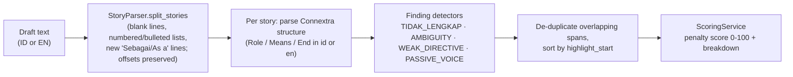

# Requirements analysis (Stage-1 rule engine)

Stage 1 is the deterministic, always-available analysis layer of ReqLint. It is implemented in
`backend/app/services/nlp_stage1.py`, `story_parser.py`, and `scoring.py`, with bilingual term
lists in `backend/app/lexicon/`. The same conceptual engine also exists in the browser
(`frontend-qa/src/lib/analyzer/`) for the landing demo and offline fallback — the two are
independent implementations with slightly different rule sets (backend: 4 categories; browser: 5,
adding `non-testable`).

## Pipeline

## Detection rules

| Category (code) | ISO 29148 characteristic | Detection | Default severity |
|---|---|---|---|
| `TIDAK_LENGKAP` (incomplete) | `complete` | Missing Role, Means, or End clause per the Connextra template (regex-parsed in Indonesian *sebagai … / saya ingin … / sehingga …* and English *as a … / i want … / so that …*) | HIGH (penalty weight 15) |
| `AMBIGUITY` (ambiguity) | `unambiguous` | Word-boundary regex over combined Indonesian + English vague-term lexicons (`vague_terms_id.txt`, `vague_terms_en.txt`); a hardcoded severe subset (e.g. *cepat/fast*, *mudah/easy*) is rated HIGH | HIGH for severe terms, otherwise MEDIUM (weight 8) |
| `WEAK_DIRECTIVE` | `verifiable` | Weak modal/directive lexicon (`weak_directives.txt`, e.g. *sebaiknya*, *should*, *can*) | MEDIUM (weight 5) |
| `PASSIVE_VOICE` | `unambiguous` | Indonesian `di` + verb regex; English via spaCy dependency pass (`nsubjpass`/`auxpass`, VBN + be/get) — English passive detection only when the story language is `en` | MEDIUM (weight 6) |

Language handling: the story language is parsed per draft (`parse_structure` picks the language
whose Connextra patterns matched); the ambiguity lexicons are applied to both languages. Findings
carry `story_index`, `highlight_start`/`highlight_end` (character offsets into the original
draft), and a `saran_perbaikan` recommendation string.

## Scoring

`ScoringService.calculate_score` (`backend/app/services/scoring.py`):

- Per-story penalty = Σ (category weight × severity multiplier); multipliers: LOW 0.5,
  MEDIUM 1.0, HIGH 1.5.
- The score starts at 100 and subtracts the average penalty across stories (clamped to 0–100).
- Where the caller supplies INVEST evaluation results with failures, 4.0 additional points are
  deducted per failed criterion. The rule-based audit path does not supply such results (its INVEST
  dimensions are reported `INSUFFICIENT_EVIDENCE`), so this deduction applies only to callers that
  do (the legacy `/requirements/audit` analyzer).
- `compute_breakdown` derives ISO 29148 and INVEST sub-scores; any dimension without evaluation
  data is returned as `null` ("not evaluated") — never fabricated.

## Where Stage 1 runs

| Entry point | Behavior |
|---|---|
| `POST /api/v1/lint` | Stateless lint of the posted text (auth required); empty input short-circuits to a perfect score with no findings |
| `POST /api/v1/audits` (rule_based evaluator) | Stage 1 runs inside the audit pipeline; findings are persisted as `TemuanCacat` rows (`stage=1`) |
| `POST /audits/{id}/apply` / `PUT /audits/{id}/revision` | Synchronous Stage-1 re-score of the revised draft |
| `POST /api/v1/requirements/audit` | Legacy standalone analyzer; also combines `InvestMLService.evaluate_story` (heuristic-or-ML hybrid) for INVEST labels |
| Landing page demo & editor fallback | In-browser copy (`frontend-qa/src/lib/analyzer/`), categories: `ambiguity`, `non-testable`, `incomplete`, `weak-directive`, `passive-voice` |

## Honest scope notes

- The rule engine judges **surface text quality** (ambiguity, completeness of the Connextra
  template, weak wording, passive voice). It does **not** evaluate INVEST semantics — that is the
  job of the Traditional ML or LLM evaluators, and the rule-based audit reports those dimensions
  as `INSUFFICIENT_EVIDENCE` rather than guessing.
- Findings are lexicon/regex-based: recall depends on the term lists; they are not a substitute
  for human review.
- spaCy's `en_core_web_sm` model is required for English passive-voice dependency parsing; if the
  model cannot be loaded, the service falls back to `spacy.blank("en")` and English passive
  detection degrades accordingly (Indonesian rules are regex-based and unaffected).
