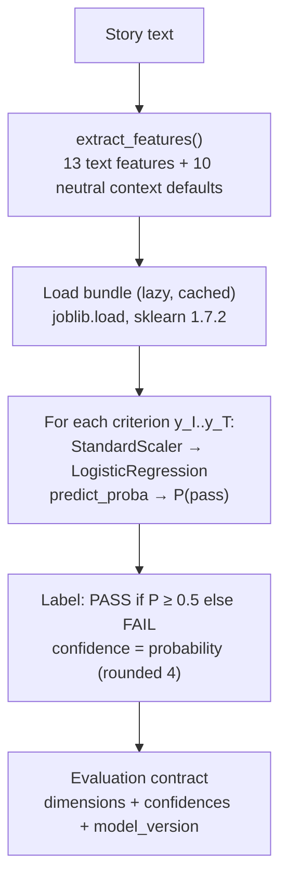

# Traditional ML evaluation (Evaluator B)

The Traditional ML evaluator runs **genuine scikit-learn inference** — trained logistic-regression
pipelines scoring the six INVEST criteria with real probabilities. It is one of three interchangeable
audit evaluators (with rule-based and LLM) and is the Task-06 deliverable. Everything below is
verified against the artifact `pm-docs/rubrics/reqlint_invest_models.pkl`, the service
`backend/app/services/invest_ml_service.py`, and the repo's pinned dependencies (`bfe72aa`).

## The model bundle

| Property | Value |
|---|---|
| Path (source of truth) | `pm-docs/rubrics/reqlint_invest_models.pkl` (15,286 bytes) |
| Bundle `version` | `2.1.0-srs-hybrid` |
| Contents | `models`, `feature_names` (23), `targets`, `metrics`, `top_features`, `version` |
| Estimators | Six sklearn `Pipeline`s: `StandardScaler → LogisticRegression`, each exposing `predict_proba` |
| Unpickling requirement | `scikit-learn==1.7.2`, `joblib>=1.3.0` (pinned in `backend/requirements.txt`) |

The six pipelines are **not six separate product features** — each pipeline is a binary classifier
for one INVEST criterion, mapped by `TARGET_KEY_MAP` in the service:

| Bundle key | Criterion | Embedded accuracy (all) | Embedded F1 (all) | F1 (id) | F1 (en) |
|---|---|---|---|---|---|
| `y_I` | independent | 0.754 | 0.525 | 0.560 | 0.486 |
| `y_N` | negotiable | 0.782 | 0.868 | 0.889 | 0.845 |
| `y_V` | valuable | 0.773 | 0.869 | 0.836 | 0.901 |
| `y_E` | estimable | 0.660 | 0.703 | 0.708 | 0.697 |
| `y_S` | small | 0.698 | 0.785 | 0.790 | 0.781 |
| `y_T` | testable | 0.677 | 0.741 | 0.726 | 0.755 |

The table above reproduces the `metrics` payload **embedded in the bundle verbatim**. These are
training-time evaluation numbers reported by the artifact itself; this documentation did not
independently re-evaluate the model. Note the spread: `negotiable` and `valuable` score high while
`independent` (F1 ≈ 0.49–0.56) is weak — treat ML verdicts as auxiliary signals, not ground truth.

## Features (23)

The service builds one feature vector per story (`extract_features`):

**13 text-derived features** (computed from the story text): `word_count`, `has_role`,
`has_means`, `has_ends`, `prescriptive_count`, `vague_count`, `dependency_word_count`,
`conjunction_count`, `has_number_metric`, `is_tech_task`, `foundational_anchor_flag`,
`sub_modifier_count`, `epic_broad_count` — produced by 12 compiled bilingual regex pattern sets
that mirror the annotation guideline's defect categories.

**10 context features** (backlog similarity and category position): `max_sim_backlog`,
`mean_top3_sim_backlog`, `sim_over_03_count`, `cat_size`, `rel_pos_in_cat`, `is_first_in_cat`,
`max_sim_prev_in_cat`, `mean_sim_prev_in_cat`, `max_sim_in_cat`, `is_most_central_in_cat`.

⚠️ **Documented serving limitation** (also stored in every ML audit's metadata): the context
features were computed over a full backlog at training time; in single-story serving mode they take
**neutral defaults**. The models were trained with real context values — this mismatch is a known,
honestly-disclosed limitation, not a hidden behavior.

## Inference flow

## Loading and availability

- The bundle is loaded **lazily on first use** and cached at class level (`_load_model_bundle`).
  Startup does not touch it — a missing bundle does not prevent the app from starting.
- Four candidate paths are probed in order: `<repo>/pm-docs/rubrics/reqlint_invest_models.pkl`,
  `<repo>/pm-docs/rubrics/models/reqlint_invest_models.pkl`, and the same two relative to the
  current working directory. In the Docker image only the first exists
  (`/app/pm-docs/rubrics/reqlint_invest_models.pkl`, COPYied by `backend/Dockerfile`).
- A stale duplicate exists at `pm-docs/rubrics/models/reqlint_invest_models.pkl` (6,131 bytes,
  older format from an earlier training round). It is *not* copied into Docker images; the primary
  path is always tried first.

## Failure behavior — no silent fallback

`evaluate_story_ml` raises `MLEvaluatorUnavailableError` when:

- the bundle is missing or fails to load,
- the bundle lacks any of the six criterion models,
- inference fails for any reason.

`audit_service` converts this into audit status `FAILED` with code
`ML_EVALUATOR_UNAVAILABLE`; **a Traditional ML audit never returns a rule-based result as if it
were an ML result.** This strictness is pinned by
`backend/tests/test_task06_evaluators.py::test_ml_missing_artifact_raises_instead_of_regex_fallback`
and the corrupt-artifact variant.

The separate legacy method `evaluate_story` (used only by `POST /api/v1/requirements/audit`) has a
different, intentional contract: without a bundle it returns **rule-based heuristic estimates**
derived from the feature vector, and with a bundle it uses `model.predict`; a missing
per-criterion model yields `null` (UNKNOWN), not a fabricated pass.

## Training provenance (as verifiable in-repo)

- The tracked generator script `pm-docs/rubrics/coba 2.py` trains the six logistic-regression
  pipelines from the labeled bilingual CSV datasets in
  `pm-docs/rubrics/dataset-indo-label-final/` and `pm-docs/rubrics/dataset-eng-label-final/`
  (13 repos each) and writes the bundle with `version: '2.1.0-srs-hybrid'`,
  `feature_names`, and per-criterion `top_features`.
- The broader corpus program (1,000-story corpus, controlled perturbation, test-set isolation —
  natural stories only) is documented in `pm-docs/rubrics/dataset_sourcing_and_perturbation.md`
  and implemented in `ai-engine/data_pipeline/`; the annotation protocol lives under
  `docs/annotation_preparation/`.
- There is **no CI training job**: the bundle is versioned in Git like any other artifact, and
  retraining is a manual process.

## Verification status

| Claim | Evidence |
|---|---|
| Bundle schema, 23 features, 6 pipelines | Loaded and inspected directly (this repo, `bfe72aa` artifact) |
| Runs under pinned deps | Verified with an isolated `scikit-learn==1.7.2` environment; genuine `predict_proba` inference on bilingual samples |
| Docker availability of the artifact | `backend/Dockerfile` COPY + scoped `.dockerignore` exception (PR #25); context-level verification performed |
| End-to-end ML audit over HTTP | Verified locally: live-server audit returned `actual_evaluator=traditional_ml`, `model_version=2.1.0-srs-hybrid`; also pinned by `test_task10_evaluator_pipeline.py` |
| Production inference | Pending the deployment of the fixed image (PR #25 merge + Coolify redeploy) |
| Embedded metrics correctness | Reported as embedded metadata; not independently re-evaluated |
