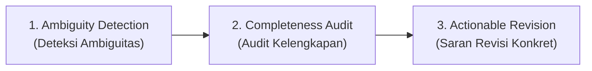

# 🚀 ReqLint: Requirement Analyzer via NLP
> **Project Proposal • Software Engineering (PPL) • Semester 5**  
> *An Automated Quality Assurance & Ambiguity Detection Tool for Software Requirement Specifications (SRS) based on IEEE 29148 Standard and INVEST Criteria.*

---

## 📌 Slide 1: Cover & Identitas Proyek
* **Nama Proyek**: ReqLint: Requirement Analyzer via NLP
* **Deskripsi**: Alat penjamin mutu (*Quality Assurance*) dan pendeteksi ambiguitas otomatis untuk Spesifikasi Kebutuhan Perangkat Lunak (SRS) berdasarkan standar ISO/IEC/IEEE 29148 dan kriteria INVEST.
* **Konteks**: Proposal Proyek Pembangunan Perangkat Lunak (PPL) — Kelompok 3 (Kelas I4).

---

## 🛑 Slide 2: The Core Problem
**Pertanyaan Mendasar**: *Why do software projects fail early in the Software Development Life Cycle (SDLC)?*

* **Fakta Lapangan**: Mayoritas kegagalan proyek perangkat lunak bukan bermula dari kesalahan penulisan kode (*coding bug*), melainkan dari cacat spesifikasi kebutuhan (*ambiguous and poorly scoped requirements*) yang tidak terdeteksi sejak fase hulu (*upstream*).

---

## 🔍 Slide 3: Shift-Left Quality Assurance
Pendekatan proaktif mendeteksi cacat sebelum komitmen sprint:

* **Early Defect Origins**: Lebih dari **60% cacat perangkat lunak** berakar dari kebutuhan awal yang ambigu, multitafsir, atau tidak lengkap.
* **Exponential Cost Increase**: Memperbaiki cacat kebutuhan saat sistem sudah berada di tahap produksi (*production*) berbiaya hingga **100× lebih mahal** dibandingkan menangkapnya di fase perancangan/analisis kebutuhan.
* **Subjective Language**: Kosakata non-kuantitatif seperti *"fast"*, *"user-friendly"*, dan *"secure"* tidak memiliki kriteria keberterimaan (*acceptance criteria*) yang terukur.
* **The Solution**: Linting terotomatisasi bertenaga NLP untuk dokumen SRS dan Agile User Stories sebelum masuk komitmen sprint backlog.

---

## 📐 Slide 4: Standardized Analysis Framework
ReqLint menggabungkan dua standar acuan industri terkemuka:

| Standar Acuan | Cakupan & Fokus | Kriteria Utama |
|---|---|---|
| **ISO/IEC/IEEE 29148 Standard** | Standar internasional rekayasa kebutuhan perangkat lunak dan sistem | Unambiguous, Complete, Consistent, Verifiable, Traceable |
| **INVEST Criteria for Agile** | Evaluasi kualitas User Story sebelum disepakati ke dalam backlog sprint | Independent, Negotiable, Valuable, Estimable, Small, Testable |

---

## 🏛️ Slide 5: Three Pillars of Requirement Audit
ReqLint beroperasi di atas tiga pilar utama penjaminan mutu:



1. **Ambiguity Detection**:
   * Mengidentifikasi direktif lemah (*weak directives*), kata sifat subjektif, dan bentuk kalimat pasif yang mengaburkan tanggung jawab aktor sistem.
2. **Completeness Audit**:
   * Memeriksa pemenuhan struktur kebutuhan (*Role - Action - Benefit*) dan memverifikasi keberadaan kriteria penerimaan yang dapat diuji (*testable acceptance criteria*).
3. **Actionable Revision**:
   * Menghasilkan saran perbaikan real-time dan usulan penulisan ulang konkret (*AI Rewrite*) menggunakan kombinasi heuristik NLP deterministik dan penalaran SLM/LLM.

---

## 🏗️ Slide 6 & 7: Architecture & Tech Stack Overview
Arsitektur terpisah (*Decoupled Micro-services*) yang modular, tangguh, dan dirancang untuk kolaborasi tim 4 orang:

```mermaid
flowchart TD
    Client["Browser / User"] -->|HTTP / HTTPS| FE["Frontend UI (Next.js 14)"]
    FE -->|REST API (JSON)| BE["Backend API (FastAPI)"]
    BE --> DB[("PostgreSQL<br>Audit History & Users")]
    BE --> Cache[("Redis Queue")]
    Cache --> Celery["Celery Background Worker"]
    BE --> NLP["Hybrid NLP Engine"]
    NLP --> SpaCy["Rule-Based Matcher (spaCy)"]
    NLP --> Groq["Groq / LLaMA-3 (Reasoning & Diff)"]
```

* **Decoupled Architecture**: Next.js 14 Frontend berkomunikasi dengan FastAPI Backend melalui REST API terstruktur.
* **Hybrid NLP Pipeline**: Pencocokan aturan deterministik instan (<50ms via spaCy) dipadukan dengan Groq API / LLaMA-3 untuk penalaran semantik dan *rewriting*.
* **Async Task Processing**: Antrean Redis + Celery untuk menangani pemrosesan dokumen batch berukuran besar tanpa memblokir thread HTTP.
* **Persisted Audit Logs**: Database PostgreSQL menyimpan histori audit spesifikasi dan versi revisi untuk pelacakan progres.

---

## 💻 Slide 8: Detailed Technology Stack

| Layer | Technologies Selected | Key Purpose / Justification |
|---|---|---|
| **Frontend UI** | Next.js 14, Tailwind CSS, Monaco Editor | Penyorotan teks interaktif, real-time diff viewer, dan editor perbaikan instan. |
| **Backend API** | FastAPI (Python 3.11+), Pydantic v2 | API I/O asinkron performa tinggi dengan dokumentasi otomatis Swagger / OpenAPI. |
| **AI / NLP Engine** | spaCy, LangChain, Groq LLaMA-3, HuggingFace | POS tagging, rule-based smell linting, dan saran kontekstual cerdas. |
| **Database & Queue** | PostgreSQL, Redis, Celery | Penyimpanan data relasional, riwayat audit, dan pemrosesan latar belakang. |
| **DevOps & QA** | Docker, PyTest, Cypress, GitHub Actions | Lingkungan multi-kontainer terisolasi, pengujian unit, integrasi, dan E2E otomatis. |

---

## 👥 Slide 9: Team Division & Roles (4 Members)

```
┌─────────────────────────────────┬─────────────────────────────────┐
│ 1. PM & Architect               │ 2. AI / NLP Engineer            │
│ Farhan (Lead)                   │ Member 2                        │
│ • System architecture design    │ • NLP parsing pipeline          │
│ • SRS project spec              │ • POS & NER rule-matching       │
│ • Metric scoring rubrics        │ • LLM prompt engineering        │
│ • Sprint management             │ • Benchmark evaluation          │
├─────────────────────────────────┼─────────────────────────────────┤
│ 3. Backend Engineer             │ 4. Frontend + QA Engineer       │
│ Member 3                        │ Member 4                        │
│ • FastAPI endpoints             │ • Interactive requirement editor│
│ • DB schema & migrations        │ • Real-time score visualizer    │
│ • Async Redis worker queue      │ • System unit & Cypress tests   │
│ • Auth & document history API   │ • UI/UX design integration      │
└─────────────────────────────────┴─────────────────────────────────┘
```

---

## 📅 Slide 10: Semester Project Roadmap

```mermaid
gantt
    title Roadmap Proyek ReqLint (16 Minggu)
    dateFormat  X
    axisFormat W%X
    section Sprint 1
    SRS & Pitching, Rule Rubric, DB Schema :0, 4
    section Sprint 2
    Core NLP Pipeline, FastAPI, Basic Editor UI :4, 8
    section Sprint 3
    Hybrid SLM Reasoning, Real-time Highlighting, QA :8, 12
    section Sprint 4
    System Evaluation, Final Demo & Paper Submission :12, 16
```



* **Weeks 1 – 4**: SRS & Pitching, definisi rubrik aturan audit, perancangan skema database awal.
* **Weeks 5 – 8**: Pembangunan Core NLP Pipeline, integrasi FastAPI, antarmuka Editor dasar.
* **Weeks 9 – 12**: Penalaran Hybrid SLM, penyorotan teks real-time di Monaco Editor, pengujian QA terpadu.
* **Weeks 13 – 16**: Evaluasi sistem, demo akhir PPL, dan penyusunan naskah publikasi ilmiah.

---

## 🔬 Slide 11: Research & Publication Potential
* **Nilai Akademik Tinggi**: Target publikasi konferensi internasional IEEE atau Jurnal Terakreditasi Sinta 2.
* **Fokus Kebaruan (Novelty)**: Perbandingan empiris yang membuktikan bahwa pipeline Hybrid NLP (*Rule-Based + SLM Reasoning*) menghasilkan tingkat *false-positive* yang signifikan lebih rendah dibandingkan penggunaan *raw LLM* langsung pada rekayasa kebutuhan.

---

## 🎯 Slide 12: Ready for Pitching
> **"ReqLint: Empowering Software Engineers with Flawless Requirements."**  
> Mengeliminasi bias subjektif, mempercepat siklus verifikasi kebutuhan hingga 70%, dan mewujudkan rekayasa perangkat lunak berkualitas sejak baris kebutuhan pertama.

---

## 🔗 Slide 13: Image Sources & Referensi
1. Dev.to Community Article: Modern Requirement Engineering Visuals.
2. Microsoft Learn Architecture Center: Azure Web Application Architecture reference (`image5-5.png`).
