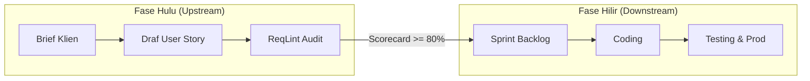
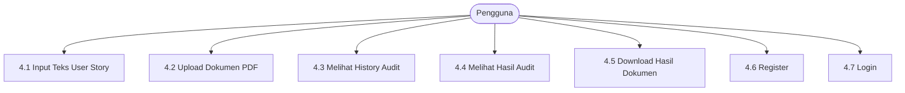

# 📑 Software Requirements Specification (SRS)
## ReqLint: Requirement Analyzer via NLP
> **Nomor Dokumen**: `UTS_I4_REQLINT_SRS` (Versi 1.0 Disetujui)  
> **Standar Acuan**: ISO/IEC/IEEE 29148:2018 & INVEST Criteria  
> **Penyusun**: Kelompok 3 (Kelas I4) — Universitas Airlangga  
> * **Daniel Purnomo** (187241001)
> * **Mochammad Farhan Akbar** (187241002)
> * **Bima Akbar Rizqullah** (187241077)
> * **Andreas Pratama Syahputra** (187241101)  
> **Tanggal Rilis**: 7 Oktober 2026

---

## 1. Pendahuluan (Introduction)

### 1.1 Tujuan (Purpose)
Dokumen Spesifikasi Kebutuhan Perangkat Lunak (*Software Requirements Specification* - SRS) ini mendefinisikan kebutuhan fungsional dan non-fungsional untuk platform **ReqLint (Requirement Analyzer via NLP)** versi 1.0. ReqLint dirancang untuk membantu *System Analyst*, *Product Manager*, dan pengembang perangkat lunak dalam mengevaluasi, menganalisis, serta meningkatkan kualitas penulisan **Agile User Story** secara otomatis melalui pendekatan **Hybrid NLP** (*Rule-Based Matching* + *Small Language Model Reasoning*) berlandaskan standar **ISO/IEC/IEEE 29148** dan kriteria **INVEST**.

### 1.2 Konvensi Dokumen (Document Conventions)
* Kebutuhan prioritas tinggi ditandai dengan **High (M)** (*Mandatory / Must Have*).
* Kebutuhan prioritas sedang ditandai dengan **Medium (S)** (*Should Have*).
* Penomoran kebutuhan menggunakan kode terstandarisasi:
  * `FR-xx`: *Functional Requirement*
  * `NFR-xx`: *Non-Functional Requirement*

### 1.3 Sasaran Pembaca (Intended Audience)
1. **Pengembang (*Developers*)**: Pedoman teknis implementasi REST API, database, frontend, dan AI pipeline.
2. **Penguji (*Testers / QA*)**: Acuan skenario uji (*test cases*), integrasi, dan pengujian E2E Cypress.
3. **Analis Sistem (*System Analysts*)**: Pemahaman alur kerja masukan klausul, mitigasi ambiguitas, dan penjaminan mutu.
4. **Manajer Proyek (*Project Manager*)**: Instrumen pelacakan ruang lingkup (*scope*), progres sprint, dan kepatuhan arsitektur.

### 1.4 Ruang Lingkup Produk (Product Scope)
ReqLint beroperasi secara spesifik pada klausul kebutuhan tangkas (*Agile User Stories*) berbasis template **Connextra** (*"Sebagai [peran], saya ingin [aksi/fungsi], sehingga [manfaat]"*). Sistem melakukan inspeksi otomatis terhadap ambiguitas leksikal (*vague quantifiers, weak directives, subjective adjectives*), kalimat pasif tanpa aktor eksplisit, serta menghasilkan usulan revisi terukur (*AI Rewrite*) dan kriteria penerimaan otomatis (*Given-When-Then*).

### 1.5 Referensi Standar
1. **ISO/IEC/IEEE 29148:2018**: *Systems and software engineering — Life cycle processes — Requirements engineering*.
2. **Kriteria INVEST**: *Agile Software Development* (Bill Wake / Mike Cohn) — *Independent, Negotiable, Valuable, Estimable, Small, Testable*.
3. **Template Connextra**: Struktur penulisan User Story berbasis peran, kemampuan, dan nilai bisnis.
4. **Femmer et al. (2014)**: *Rapid Requirements Checks with Requirements Smells*.

---

## 2. Deskripsi Umum (Overall Description)

### 2.1 Perspektif Produk
ReqLint merupakan aplikasi web mandiri (*standalone cloud-native web application*) dengan pendekatan **Shift-Left Quality Assurance**. Sistem mendeteksi cacat spesifikasi sedini mungkin sebelum sprint backlog disepakati, mencegah pembengkakan biaya perbaikan di hilir hingga 100× lebih murah.

### 2.2 Fungsi Utama Produk
1. **Input Teks Interaktif**: Editor langsung dengan penandaan kesalahan sintaksis dan ambiguitas.
2. **Ekstraksi Berkas PDF**: Penguraian klausul kebutuhan otomatis dari dokumen PDF via PyMuPDF.
3. **Hybrid NLP Analysis Engine**:
   * *Stage 1*: Rule-based linting deterministik instan (<50ms via spaCy).
   * *Stage 2*: Penalaran semantik dan perbaikan kalimat via SLM/LLM (Groq / LLaMA-3).
4. **Quality Scorecard & Diff Viewer**: Skor kelayakan 0–100% dan perbandingan sebelum vs sesudah revisi.
5. **Ekspor Laporan Multi-Format**: Ekspor hasil audit ke format PDF, Markdown, dan JSON.
6. **Autentikasi & Histori Audit**: Pengelolaan sesi pengguna dan pelacakan audit log persisten.

### 2.3 Karakteristik Pengguna
| Kelas Pengguna | Deskripsi Peran | Hak Akses Utama |
|---|---|---|
| **System Analyst / PM** | Pengguna utama perumus kebutuhan | Input teks, unggah PDF, terima saran AI, ekspor laporan, lihat riwayat. |
| **Developer / Engineer** | Pelaksana teknis sistem | Membaca kriteria penerimaan (Given-When-Then), memverifikasi kejelasan klausul. |
| **QA Engineer** | Penjamin mutu pengujian | Menggunakan acceptance criteria otomatis untuk merancang skenario uji (*test cases*). |

### 2.4 Lingkungan Operasional
* **Client Environment**: Web browser modern (Chrome ≥ 110, Firefox ≥ 110, Edge ≥ 110, Safari ≥ 16) pada Windows, macOS, Linux, Android, iOS.
* **Server Environment**: Linux Ubuntu 22.04 LTS / Docker Engine 24+, Uvicorn/FastAPI backend, Node.js 18+ runtime.

### 2.5 Batasan Desain & Implementasi
* **Format Kebutuhan**: Dikhususkan pada Agile User Story (Connextra & INVEST).
* **Ukuran Berkas PDF**: Maksimal 10 MB per berkas.
* **Bahasa Masukan**: Mendukung dwibahasa (*Indonesian* & *English*).

---

## 3. Kebutuhan Antarmuka Eksternal (External Interface Requirements)

### 3.1 Antarmuka Pengguna (User Interfaces)
* Dibangun menggunakan **Next.js 14**, **Tailwind CSS**, dan **Monaco Editor**.
* Desain responsif, clean dark-mode support, dan interaksi real-time tanpa refresh halaman penuh.

### 3.2 Antarmuka Perangkat Keras
* Server: Minimal 2 Core vCPU, 4 GB RAM, 20 GB SSD Storage.
* Klien: Perangkat dengan resolusi minimal 1280×720 piksel (desktop) atau layar sentuh modern (mobile).

### 3.3 Antarmuka Perangkat Lunak & Arsitektur Data
* **Backend**: FastAPI (Python 3.11+), Pydantic v2, SQLAlchemy 2.0 ORM, Alembic migrations.
* **Database Relasional**: PostgreSQL 15+.

#### Skema Basis Data Relasional Inti:
1. `user`: `(id_user, nama_lengkap, alamat_email, password_hash, tanggal_registrasi)`
2. `draf_kebutuhan`: `(id_draf, id_dokumen, id_user, judul_klausul, tipe_masukan, konten_asli, konten_revisi, status_revisi)`
3. `dokumen_upload`: `(id_dokumen, nama_dokumen, ukuran_dokumen, waktu_upload)`
4. `audit_kebutuhan`: `(id_audit, id_draf, skor_kualitas, tanggal_audit, status_audit)`
5. `temuan_cacat`: `(id_temuan, id_audit, kategori_cacat, potongan_teks_asli, saran_perbaikan, kriteria_penerimaan)`
6. `history_download`: `(id_ekspor, id_audit, format_dokumen, waktu_download)`

### 3.4 Antarmuka Komunikasi (Communications Interfaces)
* **Client-to-Server**: Protokol HTTPS RESTful API, pertukaran payload format JSON, autentikasi sesi menggunakan JWT (*JSON Web Token Bearer*).
* **Asynchronous Queue**: Redis 7.x + Celery worker via koneksi TCP/IP (`redis://`) untuk ekstraksi PDF berat dan pembuatan laporan PDF.

---

## 4. Fitur-Fitur Sistem (System Features)

### 4.1 Fitur 1: Input Teks User Story (Prioritas: High)
* **Deskripsi**: Memungkinkan pengguna mengetik atau menempelkan satu atau beberapa klausul User Story ke Monaco Editor untuk diaudit langsung.
* **Basic Path**:
  1. Pengguna mengetik kalimat kebutuhan pada antarmuka editor.
  2. Sistem menerima teks dan memvalidasi batas panjang karakter (10 – 10.000 karakter).
  3. Pengguna menekan tombol "Audit Kebutuhan".
  4. Sistem mem-parsing elemen Connextra (*Role, Means, End*), mengevaluasi kecacatan, dan menampilkan hasil evaluasi pada layar.
* **Alternative Path**: Jika input kosong atau format tidak terdeteksi, tampilkan peringatan validasi sintaksis.

### 4.2 Fitur 2: Upload Dokumen PDF (Prioritas: High)
* **Deskripsi**: Memungkinkan pengguna mengunggah berkas spesifikasi berformat PDF untuk diekstrak teks klausulnya secara otomatis.
* **Basic Path**:
  1. Pengguna memilih berkas PDF melalui tombol file picker atau *drag-and-drop*.
  2. Sistem memvalidasi ekstensi `.pdf` dan ukuran file (`≤ 10 MB`).
  3. Worker asinkron memanggil PyMuPDF (`fitz`) untuk mengurai hierarki teks per halaman.
  4. Klausul hasil ekstraksi otomatis diisikan ke editor untuk proses audit.

### 4.3 Fitur 3: Melihat History Audit (Prioritas: Medium)
* **Deskripsi**: Pengguna dapat melihat daftar seluruh rekam jejak audit yang pernah dilakukan.
* **Basic Path**:
  1. Pengguna mengakses menu "History Audit".
  2. Sistem mengambil log dari tabel `audit_kebutuhan` terurut kronologis mundur.
  3. Pengguna dapat melakukan filter berdasarkan kata kunci, tanggal, atau rentang skor kualitas.
  4. Pengguna dapat mengklik salah satu baris log untuk memuat kembali detail temuan lengkap.

### 4.4 Fitur 4: Melihat Hasil Audit ReqLint (Prioritas: High)
* **Deskripsi**: Menampilkan kartu skor kualitas, daftar temuan cacat, perbandingan revisi visual, dan kriteria penerimaan.
* **Komponen Tampilan**:
  * **Quality Scorecard**: Nilai kuantitatif 0–100% dengan status: *Excellent (≥85)*, *Acceptable (70-84)*, *Needs Improvement (<70)*.
  * **Smell Findings**: Penandaan kata ambigu, kalimat pasif, dan kata sifat subjektif disertai alasan pelanggaran.
  * **Diff Viewer**: Penyorotan perbedaan visual baris draf asli vs usulan perbaikan (*AI Rewrite*).
  * **1-Click Apply**: Tombol instan untuk menerapkan draf revisi ke editor utama.

### 4.5 Fitur 5: Download Hasil Dokumen Audit (Prioritas: Medium)
* **Deskripsi**: Mengekspor ringkasan laporan evaluasi ke perangkat lokal pengguna.
* **Format Didukung**:
  1. **PDF**: Dokumen laporan formal berformat tabel dan kop resmi.
  2. **Markdown (`.md`)**: Format portabel untuk dokumentasi Git repositori.
  3. **JSON (`.json`)**: Payload terstruktur untuk integrasi pipeline CI/CD otomatis.

### 4.6 Fitur 6: Register Akun (Prioritas: High)
* **Deskripsi**: Registrasi akun pengguna baru untuk mengisolasi data audit per user.
* **Basic Path**:
  1. Pengguna memasukkan nama lengkap, email unik, dan kata sandi (minimal 8 karakter, kombinasi alfanumerik).
  2. Sistem memverifikasi ketiadaan duplikasi email.
  3. Sistem meng-hash kata sandi menggunakan algoritma **bcrypt (salt cost ≥ 12)** dan menyimpan rekaman ke tabel `user`.

### 4.7 Fitur 7: Login & Manajemen Sesi (Prioritas: High)
* **Deskripsi**: Otentikasi pengguna terdaftar menggunakan email dan kata sandi.
* **Basic Path**:
  1. Pengguna memasukkan email dan kata sandi pada halaman login.
  2. Sistem memverifikasi kecocokan hash kredensial di database.
  3. Sistem menerbitkan **JWT Access Token** (masa berlaku 24 jam) dan mengarahkan ke dashboard utama.

---

## 5. Kebutuhan Non-Fungsional (Other Nonfunctional Requirements)

### 5.1 Kebutuhan Performa (Performance Requirements)
* **NFR-01 (Stage 1 Rule-Based Latency)**: Eksekusi pencocokan aturan deterministik (spaCy) harus selesai dalam waktu **< 50 milidetik** per klausul.
* **NFR-02 (API Response Time)**: Latensi respons endpoint HTTP FastAPI audit draf tidak boleh melebihi **500 milidetik (p95)** untuk analisis heuristik.
* **NFR-03 (PDF Extraction Speed)**: Ekstraksi teks dokumen PDF berukuran hingga 5 MB harus tuntas dalam waktu **< 3 detik**.

### 5.2 Kebutuhan Keamanan (Security Requirements)
* **NFR-04 (Enkripsi Transmisi)**: Seluruh komunikasi data antar klien dan server wajib menggunakan protokol **HTTPS (TLS 1.3)**.
* **NFR-05 (Proteksi Kredensial)**: Kata sandi pengguna tidak boleh disimpan dalam bentuk plaintext, wajib di-hash menggunakan algoritma **bcrypt**.
* **NFR-06 (Autentikasi Aman)**: Autentikasi sesi menggunakan stateless JWT token dengan masa berlaku terbatas dan verifikasi tandatangan rahasia (*secret signature*).
* **NFR-07 (Sanitasi Input & SQLi)**: Seluruh input pengguna wajib divalidasi skemanya via Pydantic v2 dan dieksekusi via parameterized query SQLAlchemy ORM untuk mencegah serangan *SQL Injection* dan *XSS*.

### 5.3 Atribut Kualitas Perangkat Lunak (Software Quality Attributes)
* **Ketersediaan (*Availability*)**: Tingkat uptime layanan ditargetkan minimal **99.5%**.
* **Kemudahan Pemeliharaan (*Maintainability*)**: Kode terstruktur secara modular dalam arsitektur decoupled monorepo dengan pemisahan dependensi yang bersih.
* **Cakupan Pengujian (*Testability*)**: Kode backend dan AI pipeline wajib memiliki cakupan unit test (*pytest*) minimal **80%**.
* **Portabilitas (*Portability*)**: Seluruh lingkungan pengembangan dan produksi dapat dijalankan secara konsisten di berbagai platform melalui `docker-compose`.

### 5.4 Aturan Bisnis (Business Rules)
* **BR-01 (Formula Connextra)**: Setiap klausul User Story wajib memenuhi tiga unsur: *Aktor/Peran*, *Aksi/Kebutuhan*, dan *Manfaat Bisnis*.
* **BR-02 (Ortogonalitas INVEST)**:
  * Kata sifat subjektif (*"cepat"*, *"mudah"*) diklasifikasikan sebagai pelanggaran kriteria **Testable (T)**.
  * Kuantitas samar (*"beberapa"*, *"banyak"*, *"dll"*) diklasifikasikan sebagai pelanggaran kriteria **Estimable (E)**.
  * Ketergantungan terhadap tiket eksternal diklasifikasikan sebagai pelanggaran kriteria **Independent (I)**.
* **BR-03 (Ambang Batas Kelulusan)**: Skor mutu keseluruhan $\geq 80\%$ dianggap *Passed / Siap Sprint*, sedangkan $< 70\%$ berstatus *Needs Improvement*.

---

## 6. Glosarium & Istilah Teknis (Glossary)
* **Connextra Template**: Template penulisan User Story: *"As a... I want to... So that..."*.
* **INVEST**: Kriteria kualitas cerita tangkas: *Independent, Negotiable, Valuable, Estimable, Small, Testable*.
* **Requirements Smells**: Indikator penulisan spesifikasi yang mengarah pada ambiguitas, inkonsistensi, atau ketidaklengkapan.
* **Shift-Left QA**: Strategi memindahkan inspeksi kualitas ke tahap paling awal siklus hidup perangkat lunak.
* **SLM (Small Language Model)**: Model bahasa kompak berparameter efisien yang dioptimalkan untuk inferensi cepat dan hemat sumber daya.
* **Given-When-Then**: Struktur penulisan kriteria penerimaan berbasis perilaku (*Behavior-Driven Development*).
